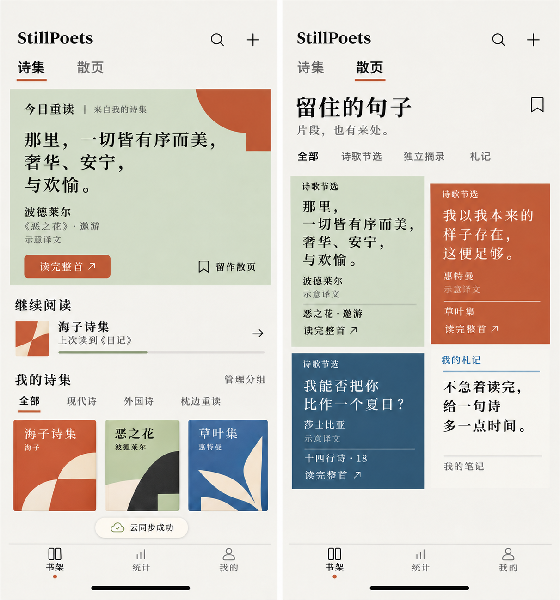
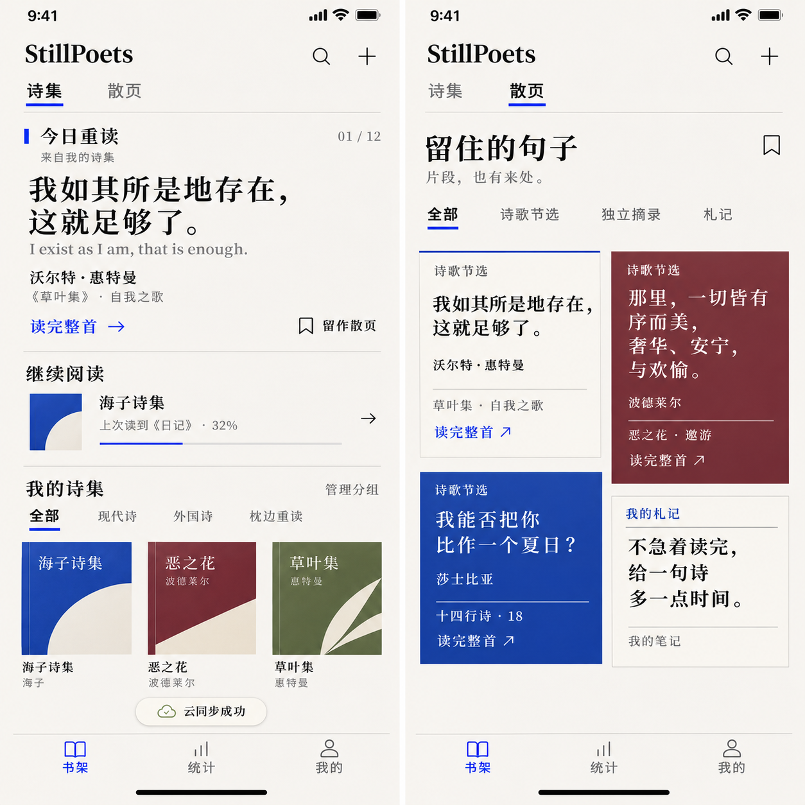
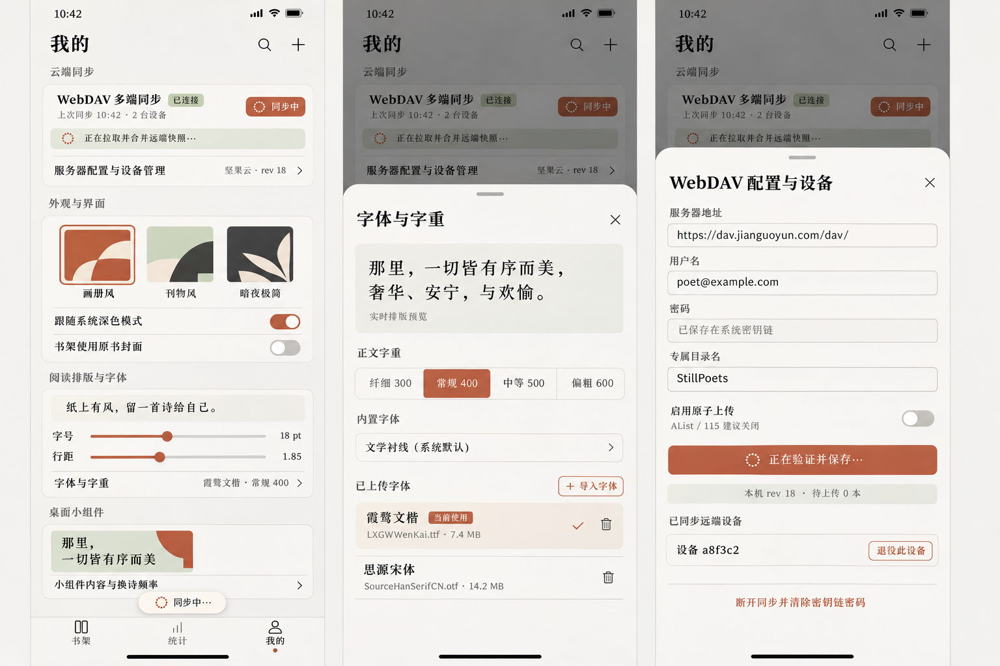

<div align="center">


# StillPoets

**让你记住，自己依然是诗人（Still a Poet）。**

私有化（BYOD）多端现代诗集阅读、独立散页管理、读诗统计、高清诗笺出卡与原生桌面小组件联动应用

[](https://github.com/sounfury/StillPoets/releases/latest)
[](./LICENSE)
[](#下载与安装)
[](https://github.com/egoist/mygo)
[-2345B5)](#webdav-私有云同步)

[核心特性](#核心特性) · [界面预览](#界面预览) · [下载与安装](#下载与安装) · [桌面油猴书库助手](#零部署桌面油猴书库助手) · [WebDAV 私有云同步](#webdav-私有云同步) · [本地开发与质量门禁](#本地开发与质量门禁) · [演进路线](#演进路线)

</div>

---

## 为什么做 StillPoets？

读诗不该是一件需要正襟危坐、专门腾出整块时间才能开始的重事。

**StillPoets** 希望通过桌面小组件，把你珍藏诗集里的某一行轻轻放回日常视线里——每次解锁屏幕、片刻停顿，抬眼即可与一首诗不期而遇；轻点诗笺，便无缝展开整首诗并定位到那一瞬打动你的诗行。

所有诗集、摘录、阅读进度与统计记录完全由你掌控，存放在你自己的设备与 WebDAV 网盘中，无任何中心化内容服务器。

---

## 核心特性

### 1. 双入口内容组织（互不污染）
- **入口 A · 诗集体系**：原生解析 EPUB 诗集（自动识别章节分类、题记、落款与行内注释，自动备份原文件），支持自定义分组、书架原地整理（批量移组 / 标星 / 软删）、抽象出版书封或 EPUB 原书封面切换、整诗 ❤️ 收藏。
- **入口 B · 独立散页库**：错位纸卡瀑布流收纳两类摘录——来自阅读器划选的「诗歌节选」（携带出处并支持 `读完整首 ↗` 溯源）与随时记下的「独立散句」，支持按类型、出处与作者筛选。

### 2. 沉浸式现代诗阅读器与全文检索
- **顺滑阅读手势**：长诗单页上下滚动，左右跟手滑动切换上一首 / 下一首诗；诗集与散页视图同样支持跟手横滑切换。
- **读书级长按跨行选区与悬浮菜单**：长按任意诗行（桌面端兼容右键）即高亮该行并显示起止圆点竖杆手柄，拖动手柄即可跨行、跨诗节自由扩选或反向翻转；上方悬浮菜单支持一键 `选本节` / `全选` / `勾选`（非连续多选），并一步直达 `复制` / `留散页` / `设为金句` / `分享`，顶栏保持极简专注整诗分享。
- **目录与全局全文检索**：目录抽屉内置实时搜索栏，支持按诗题与正文多词过滤；全局检索展示命中正文摘要与所属诗集名，点击直达对应诗篇并高亮定位。
- **纸书排版与偶遇进度保护**：支持导入本地 `.ttf` / `.otf` 字体、4 档字重与实时标本预览；严格区分「主线顺序阅读」与「偶遇直达」（桌面小组件、今日重读、散页溯源、全局检索），偶遇仅计入已读不覆盖主线续读位置，并支持一键回到进度或从当前续读。

### 3. 完整读诗统计看板
- **有效读诗静默采集**：停留满 5 秒自动记录（短诗读完 `>= 1.5s` 切离补记；点亮 ❤️ / 留散页 / 设金句立即确认），过滤快速扫目录噪声，并通过 WebDAV 跨设备增量去重同步。
- **多维可视化洞察**：支持「本周 / 本月 / 今年 / 全部」全局时间窗口，涵盖 **52 周 / 按年读诗热力图**（点击日期下钻当日诗篇并直达阅读）、**昼夜节律图**（五时段圆环图 / 24 小时柱状图切换）、**完读诗集墙**（支持手动标记完读/重读中与完读回望卡）以及 **诗人作者云**（综合 / 读过 / 精选权重切换，点击展开「诗人档案」弹窗）。

### 4. 高清分享卡片导出
- **纯 Go 3× 离屏渲染引擎**：直接复用自定义 `.ttf` / `.otf` 字体与棉纸肌理画布，动态测算自然高度后按 1080px 宽无裁切输出高清 PNG。
- **5 类场景 × 5 套排版 × 5 套纸色**：覆盖单句卡片、整诗长图、诗集精选合辑、完读纪念卡与周期读诗报告长图；提供极简纸笺 / 古典印章 / 刊物版式 / 日历诗笺 / 画册留白 5 套模板，以及画册风 / 刊物风 / 暗夜极简 / 宣纸素笺 / 复古牛皮纸 5 套配色，支持一键直存系统相册或系统分享。

### 5. 现代诗歌出版美学与多形态适配
- **三套内置主题**：**画册风（Artbook）**（温润棉纸肌理、实体书封折痕与接触投影）、**刊物风（Editorial）**（清亮纸白 `#FFFFFF` 与克莱因刊物蓝）、**暗夜极简（Dark Minimal）**（支持跟随系统深色模式自动切换并联动刷新桌面小组件）。
- **手机与平板自适应**：iPhone / Android 手机采用简洁底栏（iOS 支持液态玻璃悬浮胶囊切换）+ 全屏阅读；Android 平板大屏（≥ 760 DIP）自动切换为左侧窄导航轨 + 左书架 / 右阅读双栏工作区。

### 6. 双端原生桌面小组件联动
- **iOS（WidgetKit）**：支持小 / 中 / 大号桌面小组件与 iOS 17+ 原地一键换诗（AppIntents），App Group 优先并自动兼容 Keychain Access Group 共享通道。
- **Android（AppWidget）**：支持 4×2 至 4×4 自由缩放、跨诗节长摘要排版、桌面右上角换诗以及自定义 `.ttf` / `.otf` 字体渲染。
- **灵活调度与高亮直达**：支持 4 种诗集抽选策略与散页池、手动选句设为本诗金句、15 分钟～每天自动换诗频率；点击小组件经 `stillpoets://` Deeplink 唤起 App，未下载诗集自动按需拉取并高亮定位原诗行。

---

## 界面预览

<table>
  <tr>
    <td align="center" width="50%">
      
      <br /><sub><b>画册风（Artbook）</b> · 书架与散页瀑布流</sub>
    </td>
    <td align="center" width="50%">
      
      <br /><sub><b>刊物风（Editorial）</b> · 清亮纸白与刊物蓝</sub>
    </td>
  </tr>
  <tr>
    <td align="center" width="50%">
      
      <br /><sub><b>平板大屏适配</b> · 左侧窄轨 + 书架与整诗阅读双栏</sub>
    </td>
    <td align="center" width="50%">
      
      <br /><sub><b>我的与设置</b> · 云同步、自定义字体与小组件配置</sub>
    </td>
  </tr>
</table>

---

## 下载与安装

前往 [**Releases 页面**](https://github.com/sounfury/StillPoets/releases/latest) 获取最新双端安装包：

### Android（手机 & 平板）
- 最低要求：**Android 8.0（API 26）+**。
- 下载 `StillPoets-<version>-android-arm64.apk` 安装即可；采用**固定正式发布签名**，后续可直接在应用内自动检测更新、校验 SHA-256 并覆盖升级。
- 安装后可在系统桌面长按添加 StillPoets 诗笺小组件。

### iOS（iPhone）
- 最低要求：**iOS 17.0+**。
- Release 默认提供免证书未签名真机包 `StillPoets-<version>-ios-arm64-unsigned.ipa`（已内置 `StillPoetsWidget.appex` 桌面小组件），可使用 **全能签 / 轻松签 / AltStore / SideStore** 等工具自签安装。
- **第三方软件源订阅**（推荐，在全能签 / 轻松签 / AltStore / SideStore 中「添加软件源」粘贴以下任一地址，发新版本后可直接刷新更新）：
  - GitHub Raw：`https://raw.githubusercontent.com/sounfury/StillPoets/main/apps.json`
  - jsDelivr CDN：`https://cdn.jsdelivr.net/gh/sounfury/StillPoets@main/apps.json`
- 如需云端直接签名，可 Fork 本仓库后在 GitHub Actions 中运行 `Build iOS IPA (with WidgetKit)`（`signed` 模式）并配置签名 Secrets。

---

## 零部署桌面油猴书库助手

为方便在电脑浏览器批量整理书库与快速投递 EPUB，仓库内置单文件零依赖油猴脚本（现已更新至 `v0.1.5`）：

- **一键安装（GitHub Raw，支持自动更新）**：[`scripts/stillpoets-manager.user.js`](https://raw.githubusercontent.com/sounfury/StillPoets/main/scripts/stillpoets-manager.user.js)
- **纸书极简全屏管理台**：Shadow DOM 隔离，仅在独立可信入口配置 WebDAV 凭据（绝不在第三方网站暴露密码输入）；采用 2A 累计稀疏快照协议，仅管理 `groups` / `books`，绝不污染收藏、散页、进度与统计数据。
- **批量整理与 EPUB 投递**：支持批量移组、标星、软删、安全墓碑原件清理，以及拖拽多本 EPUB 直传 WebDAV `inbox/`。
- **Z-Library 一键直投**：兼容新版 Z-Library 详情页异步渲染与 Shadow DOM 下载按钮，在下载栏正下方内联嵌入投递按钮，通过 `GM_xmlhttpRequest` 复用登录态并绕过跨源 CDN CORS 拦截，自动还原 `filename*=UTF-8''` 与 Latin-1 中文文件名乱码；投递后任意移动设备切回前台即自动无感消费入库。

---

## WebDAV 私有云同步

StillPoets 采用 **BYOD（自带存储）+ 元数据与正文物理分离** 的同步架构：

- **兼容常见网盘与自建服务**：实测兼顾 **坚果云、Nextcloud、群晖 NAS** 与 **AList / OpenList（含 115 挂载点）**——支持低并发限流保护、防抖批量串行提交、遵守 `Retry-After`、禁止不安全重定向降级、强制 `Accept-Encoding: identity`、可选关闭原子 MOVE 覆盖。
- **无冲突并发模型**：采用 **Per-Device 单写者代次快照**（`StillPoets/state/device_<installId>_<rev>.json.gz`，保留最近 2 份已校验代次）与 **Lamport 逻辑时钟字段级确定性合并**，杜绝多设备同时写入覆盖。
- **完整元数据与 `inbox/` 投递闭环**：同步书目分组、书籍元数据（含不可变 `contentPath`）、收藏、散页、阅读进度与 `readingEvents` 增量阅读事件；App 从后台切回前台支持 15 秒防抖静默同步，先刷书架再校验消费 `StillPoets/inbox/<bookId>.ready.json`，并自动巡检缺失诗集正文从本地重建补传。
- **正文按需拉取 & 凭据安全隔离**：诗集解析包（`parsed.spbook.json.gz`）仅在主动阅读或缓存时按需下载；WebDAV 账号密码仅存入系统级安全存储（iOS Keychain / Android Keystore），绝不写入数据库、配置文件或诊断日志。

---

## 技术栈与目录结构

- **核心框架**：纯 Go 逻辑内核 + [MyGo](https://github.com/egoist/mygo) 原生移动端 UI（iOS Metal / Android OpenGL ES 渲染）
- **本地存储**：SQLite + FTS5 全文检索（常驻元数据表、`reading_events` 统计表、`pending_uploads` 队列与按需缓存正文表物理分离）
- **原生扩展模块**：Swift（iOS WidgetKit、Keychain / AppGroup、相册保存）与 Kotlin（Android AppWidget、Keystore、应用内更新安装、MediaStore 相册保存）

```text
StillPoets/
├── main.go                    # 应用入口、原生导航壳与平台生命周期（含前台回归同步）
├── mygo.json                  # MyGo 应用元数据、双端图标、权限与打包配置
├── apps.json                  # iOS AltStore / SideStore / 全能签软件源清单
├── resources/                 # 正式版 App 图标与 Android Adaptive 前景层
├── internal/
│   ├── domain/                # 核心领域模型（Book / Poem / Quote / Progress / ReadingEvent / WidgetTimeline）
│   ├── parser/                # EPUB 诗集解析与节选引擎
│   ├── storage/               # SQLite Schema（含 FTS5 与阅读事件统计）与本地仓储
│   ├── sync/                  # WebDAV 安全客户端、代次快照与 inbox 协议、Lamport 合并引擎
│   ├── app/                   # 应用服务编排、Deeplink 路由、应用内更新下载校验、小组件预编译与诊断日志
│   └── ui/                    # 主题 Token、纸纹肌理、组件、高清分享卡片引擎（sharecard/）与全部原生页面
├── modules/
│   ├── widgetbridge/          # 双端小组件数据与凭据安全桥接（含 Android AppWidget 实现）
│   ├── appupdater/            # Android 应用内 APK 权限探测与 FileProvider 安装桥接
│   └── photosaver/            # Android MediaStore / iOS PHPhotoLibrary 相册直存桥接
├── native/ios/                # iOS WidgetKit Extension（StillPoetsWidget.appex）工程
├── scripts/                   # 油猴书库管理脚本（含单测）与双端 CI 构建脚本
├── quality/ & .woodpecker/    # 纯 Go AST 质量检查器与 8 项 Woodpecker CI 质量门禁
└── docs/                      # PRD、系统架构文档与 V3 视觉/图标设计规范
```

---

## 本地开发与质量门禁

### 运行单元测试与静态检查

```bash
go vet ./...
go test ./quality/gocheck ./internal/domain ./internal/parser ./internal/storage ./internal/sync/... ./internal/ui/theme ./internal/ui/sharecard
```

> 说明：部分端到端 EPUB 解析/页面渲染用例需在本地 `test-books/` 目录放入个人测试用 `.epub` 诗集（该目录已在 `.gitignore` 中忽略）。油猴脚本单测可通过 `node --test scripts/stillpoets-manager.test.js` 运行。

### 代码质量门禁

项目已接入 8 项独立质量门禁（`.woodpecker/*.yaml` + `quality/`）：

- **纯 Go AST 门禁**（`quality/gocheck`，阈值见 [quality/go-quality.json](./quality/go-quality.json)）：文件行数 ≤ 800、圈复杂度 ≤ 15、认知复杂度 ≤ 20、嵌套深度 ≤ 4、参数个数 ≤ 6、零死代码。
- **重复代码与密钥扫描**：`jscpd`（阈值 0%，配置见 [quality/jscpd.json](./quality/jscpd.json)）与 `gitleaks`（零密钥泄露）。

本地快速复跑 Go 门禁：

```bash
for rule in file-length cyclomatic cognitive nesting params dead-code; do
  go run ./quality/gocheck --config quality/go-quality.json "$rule"
done
```

### 构建移动端安装包

需先安装与 [go.mod](./go.mod) 版本匹配的 `mygo` CLI：

```bash
MYGO_VER=$(go list -m -f '{{.Version}}' github.com/egoist/mygo)
go install "github.com/egoist/mygo/cmd/mygo@${MYGO_VER}"

# 构建 Android ARM64 APK（需配置 Android SDK / NDK / Java 17）
mygo build -platform android/arm64 -o build

# 构建 iOS（需 macOS + Xcode + XcodeGen，详见 .github/workflows/release-mobile.yml）
```

---

## 演进路线

- [x] **V1.0 核心能力**：EPUB 诗集解析导入、独立散页双入口、现代诗沉浸阅读器与自定义字体/字重
- [x] **多端 WebDAV 同步**：Per-Device 代次快照、Lamport 确定性合并、按需下载、AList/坚果云适配与前台自动同步
- [x] **双端原生小组件**：iOS WidgetKit（小/中/大号 + 原地换诗）与 Android AppWidget（4×2 ~ 4×4）+ `stillpoets://` 高亮直达
- [x] **V3 视觉与阅读交互打磨**：三套主题（含跟随系统深色模式）、偶遇进度保护、平板双栏、长按段落悬浮菜单、目录实时全文检索与 Android 应用内自动更新
- [x] **V1.1 读诗统计与高清出卡**：完整统计看板（完读墙 / 52 周热力图 / 昼夜节律 / 诗人作者云与档案）与 5 类场景 × 5 套模板 × 5 套纸色 3× 高清分享卡片导出
- [x] **桌面零部署书库助手与质量门禁**：油猴书库管理 / Z-Library 一键直投（WebDAV `inbox/` 无感消费）与 8 项 Woodpecker CI 质量门禁全绿
- [ ] **V1.1 后续规划**：单诗微批注与诗集长书评、古诗词竖排阅读

---

## 设计文档、开源协议与免责声明

- 产品需求文档：[docs/prd.md](./docs/prd.md)
- 系统架构文档：[docs/architecture.md](./docs/architecture.md)
- 界面视觉规范：[docs/prototypes/design-direction.md](./docs/prototypes/design-direction.md)
- **开源协议**：本项目源代码基于 [**GNU General Public License v3.0 (GPL-3.0)**](./LICENSE) 协议开源。

**版权说明**：StillPoets 仅提供本地排版渲染、个人摘录管理与用户自有 WebDAV 同步能力，**不内置、不提供、不分发任何受版权保护的图书或诗歌内容**；所有导入内容均由用户自行准备并保存于个人设备与私有存储中。
