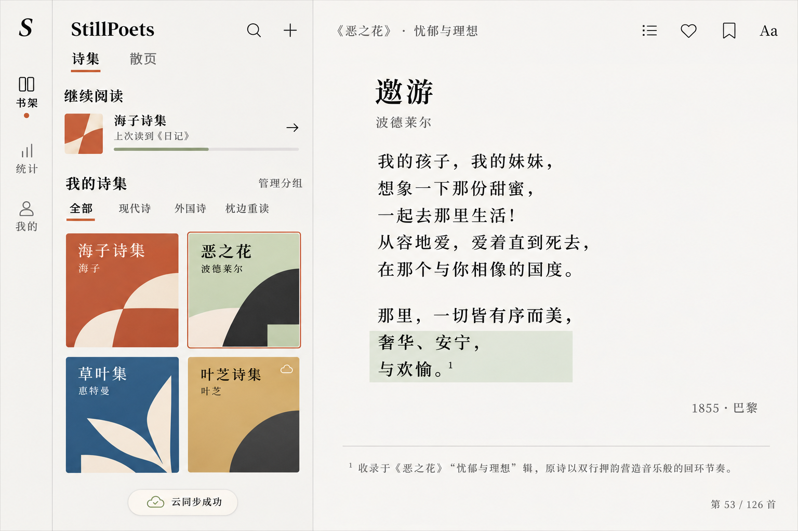

<div align="center">


# StillPoets

**让你记住，自己依然是诗人（Still a Poet）。**

私有化（BYOD）多端现代诗集阅读、独立散页管理与原生桌面小组件联动应用

[](https://github.com/sounfury/StillPoets/releases/latest)
[](#下载与安装)
[](https://github.com/egoist/mygo)
[-2345B5)](#webdav-私有云同步)

[核心特性](#核心特性) · [界面预览](#界面预览) · [下载与安装](#下载与安装) · [WebDAV 私有云同步](#webdav-私有云同步) · [本地开发与构建](#本地开发与构建) · [演进路线](#演进路线)

</div>

---

## 为什么做 StillPoets？

读诗不该是一件需要正襟危坐、专门腾出整块时间才能开始的重事。

**StillPoets** 希望通过桌面小组件，把你珍藏诗集里的某一行轻轻放回日常视线里——每次解锁屏幕、片刻停顿，抬眼即可与一首诗不期而遇；轻点诗笺，便无缝展开整首诗并定位到那一瞬打动你的诗行。

所有诗集、摘录与阅读记录完全由你掌控，存放在你自己的设备与 WebDAV 网盘中，无任何中心化内容服务器。

---

## 核心特性

### 1. 双入口内容组织（互不污染）
- **入口 A · 诗集体系**：原生解析 EPUB 诗集（自动识别章节分类、题记、落款与行内注释，自动归档原文件），支持自定义分组、无封面抽象出版书封或 EPUB 原书封面切换、整诗 ❤️ 收藏。
- **入口 B · 独立散页库**：错位纸卡瀑布流收纳两类摘录——来自诗集阅读器划选的「诗歌节选」（携带出处并支持 `读完整首 ↗` 溯源）与随时记下的「独立散句」，支持按类型、出处与作者筛选。

### 2. 沉浸式现代诗阅读器
- **贴合诗歌的交互手势**：长诗单页上下顺滑滚动，左右跟手滑动切换上一首 / 下一首诗；诗集与散页视图同样支持跟手横滑切换。
- **纸书级排版与自定义字体**：支持导入本地 `.ttf` / `.otf` 字体、4 档正文字重（纤细 / 常规 / 中等 / 偏粗）与实时诗句标本预览、目录抽屉快速跳转。
- **偶遇浏览进度保护**：区分「主线顺序阅读」与「偶遇直达」（桌面小组件、今日重读、散页回看、全局检索），偶遇仅计入已读不覆盖主线续读位置，并支持一键回到进度或从当前续读。

### 3. 现代诗歌出版美学与多形态适配
- **三套内置主题**：
  - **画册风（Artbook）**：温润棉纸肌理、鼠尾草绿、赤陶与墨蓝，实体书封折痕与接触投影。
  - **刊物风（Editorial）**：清亮纸白 `#FFFFFF`、克莱因刊物蓝与细线留白，呈现独立诗刊气质。
  - **暗夜极简（Dark Minimal）**：深炭黑与柔赤陶，支持跟随系统深色模式自动切换并同步刷新桌面小组件。
- **手机与平板自适应**：iPhone / Android 手机采用简洁底栏（iOS 支持悬浮液态玻璃胶囊切换）+ 全屏阅读；Android 平板大屏（≥ 760 DIP）自动切换为左侧窄导航轨 + 左书架 / 右阅读分栏工作区。

### 4. 双端原生桌面小组件联动
- **iOS（WidgetKit）**：支持小 / 中 / 大号桌面小组件与 iOS 17+ 原地一键换诗（AppIntents），App Group 优先并自动兼容 Keychain Access Group 共享通道。
- **Android（AppWidget）**：支持 4×2 至 4×4 自由缩放、跨诗节长摘要排版、桌面右上角换诗以及自定义 `.ttf/.otf` 字体渲染。
- **灵活抽选与内外直达**：支持 4 种诗集抽选策略与散页池、手动划句设为「本诗金句」、15 分钟～每天自动换诗频率设置；点击小组件通过 `stillpoets://` Deeplink 唤起 App，未下载诗集自动按需拉取并高亮定位原诗行。

---

## 界面预览

<table>
  <tr>
    <td align="center" width="50%">
      
      <br /><sub><b>画册风（Artbook）</b> · 书架与散页瀑布流</sub>
    </td>
    <td align="center" width="50%">
      
      <br /><sub><b>刊物风（Editorial）</b> · 清亮纸白与刊物蓝</sub>
    </td>
  </tr>
  <tr>
    <td align="center" width="50%">
      
      <br /><sub><b>平板大屏适配</b> · 左侧窄轨 + 书架与整诗阅读双栏</sub>
    </td>
    <td align="center" width="50%">
      
      <br /><sub><b>我的与设置</b> · 云同步、自定义字体与小组件配置</sub>
    </td>
  </tr>
</table>

---

## 下载与安装

前往 [**Releases 页面**](https://github.com/sounfury/StillPoets/releases/latest) 获取最新双端安装包：

### Android（手机 & 平板）
- 最低要求：**Android 8.0（API 26）+**。
- 下载 `StillPoets-<version>-android-arm64.apk` 直接安装即可；安装后可在系统桌面长按添加 StillPoets 诗笺微件。

### iOS（iPhone）
- 最低要求：**iOS 17.0+**。
- Release 默认提供免证书未签名真机包 `StillPoets-<version>-ios-arm64-unsigned.ipa`（已内置 `StillPoetsWidget.appex` 桌面小组件）。
- 可使用 **全能签 / 轻松签 / AltStore / SideStore** 等工具自签安装；如需云端直接签名，可 Fork 本仓库后在 GitHub Actions 中运行 `Build iOS IPA (with WidgetKit)`（`signed` 模式）并配置签名 Secrets。

---

## WebDAV 私有云同步

StillPoets 采用 **BYOD（自带存储）+ 元数据与正文物理分离** 的同步架构：

- **兼容常见网盘与自建服务**：实测兼顾 **坚果云、Nextcloud、群晖 NAS** 与 **AList / OpenList（含 115 挂载点）**——支持低并发限流保护、防抖批量串行提交、遵守 `Retry-After`、禁止不安全重定向降级、可选关闭原子 MOVE 覆盖以适配对象存储/挂载盘。
- **无冲突并发模型**：采用 **Per-Device 单写者代次快照**（`StillPoets/state/device_<installId>_<rev>.json.gz`，保留最近 2 份校验代次）与 **Lamport 逻辑时钟字段级确定性合并**，杜绝多设备同时写入覆盖。
- **正文按需拉取**：多端自动同步书目分组、收藏、独立散页与阅读进度；诗集解析包（`parsed.spbook.json.gz`）仅在用户主动阅读或缓存时按需下载，不占冗余空间。
- **凭据安全隔离**：WebDAV 账号密码仅存入系统级安全存储（iOS Keychain / Android Keystore），绝不写入本地数据库、配置文件或诊断日志。

---

## 技术栈与目录结构

- **核心框架**：纯 Go 逻辑内核 + [MyGo](https://github.com/egoist/mygo) 原生移动端 UI（iOS Metal / Android OpenGL ES 渲染）
- **本地存储**：SQLite + FTS5 全文检索（常驻元数据表与按需缓存正文表物理分离）
- **原生扩展**：Swift（iOS WidgetKit + Keychain/AppGroup 桥接）与 Kotlin（Android AppWidget + Keystore 桥接）

```text
StillPoets/
├── main.go                    # 应用入口、原生导航壳与平台生命周期
├── mygo.json                  # MyGo 应用元数据、双端图标与打包配置
├── resources/                 # 正式版 App 图标与 Android Adaptive 前景层
├── internal/
│   ├── domain/                # 核心领域模型（Book / Poem / Quote / Progress / WidgetTimeline）
│   ├── parser/                # EPUB 诗集解析与节选引擎
│   ├── storage/               # SQLite v2 Schema（含 FTS5）与本地仓储
│   ├── sync/                  # WebDAV 安全客户端、代次快照协议与 Lamport 合并引擎
│   ├── app/                   # 应用服务编排、Deeplink 路由、小组件时间线预编译与诊断日志
│   └── ui/                    # V3 主题 Token、纸纹肌理、动效、双形态布局与全部原生页面
├── modules/widgetbridge/      # Swift / Kotlin 原生桥接模块（含 Android 小组件实现）
├── native/ios/                # iOS WidgetKit Extension（StillPoetsWidget.appex）工程
└── docs/                      # PRD、系统架构文档与 V3 视觉/图标设计规范
```

---

## 本地开发与构建

### 运行单元测试与静态检查

```bash
go vet ./...
go test ./internal/domain ./internal/parser ./internal/storage ./internal/sync/... ./internal/ui/theme
```

> 说明：涉及完整 EPUB 解析/界面端到端渲染的部分用例需在本地 `test-books/` 目录放入个人测试用 `.epub` 诗集（该目录已在 `.gitignore` 中忽略）。

### 构建移动端安装包

需先安装与 [go.mod](./go.mod) 版本匹配的 `mygo` CLI：

```bash
MYGO_VER=$(go list -m -f '{{.Version}}' github.com/egoist/mygo)
go install "github.com/egoist/mygo/cmd/mygo@${MYGO_VER}"

# 构建 Android ARM64 APK（需配置 Android SDK / NDK / Java 17）
mygo build -platform android/arm64 -o build

# 构建 iOS（需 macOS + Xcode + XcodeGen，详见 .github/workflows/ios-build.yml）
```

---

## 演进路线

- [x] **V1.0 核心能力**：EPUB 诗集解析导入、独立散页双入口、现代诗沉浸阅读器与自定义字体/字重
- [x] **多端 WebDAV 同步**：Per-Device 代次快照、Lamport 确定性合并、按需下载与 AList/坚果云适配
- [x] **双端原生小组件**：iOS WidgetKit（小/中/大号 + 原地换诗）与 Android AppWidget（4×2 ~ 4×4）+ `stillpoets://` 高亮直达
- [x] **V3 视觉与体验打磨**：画册/刊物/暗夜三套主题、跟随系统深色模式、偶遇进度保护、平板分栏工作区、正式版 App 图标
- [ ] **V1.1 扩展功能**：单诗微批注与诗集长书评、完整统计看板（完读墙 / 按篇读诗热力图 / 时段节律 / 诗人作者云）、高清分享卡片导出、古诗词竖排阅读

---

## 设计文档与免责声明

- 产品需求文档：[docs/prd.md](./docs/prd.md)
- 系统架构文档：[docs/architecture.md](./docs/architecture.md)
- 界面视觉规范：[docs/prototypes/design-direction.md](./docs/prototypes/design-direction.md)

**版权说明**：StillPoets 仅提供本地排版渲染、个人摘录管理与用户自有 WebDAV 同步能力，**不内置、不提供、不分发任何受版权保护的图书或诗歌内容**；所有导入内容均由用户自行准备并保存于个人设备与私有存储中。
