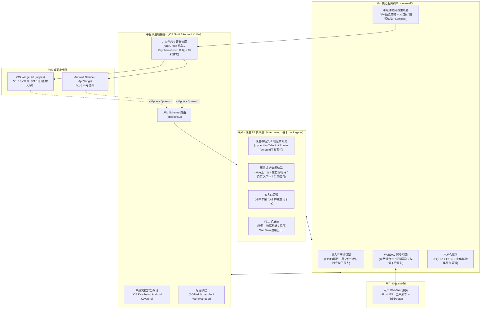
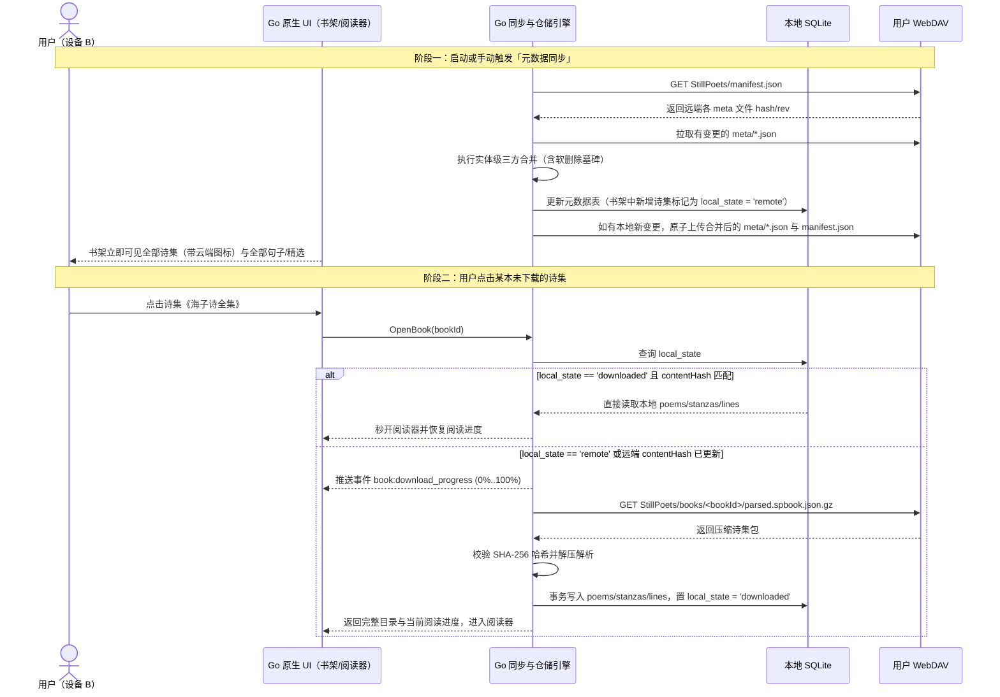
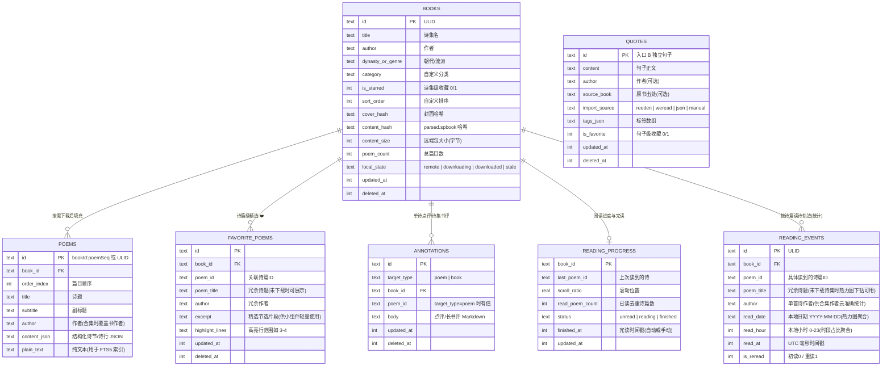

# StillPoets 系统架构设计文档

> **文档状态**：v0.2（V1.0 架构基线已确认，基于 [prd.md](./prd.md)）
> **目标平台**：第一期仅支持 **iOS（iPhone）与 Android（优先适配平板大屏）**；后续可考虑扩展 **Web / PWA**；**明确不做 Windows / macOS 桌面端**
> **核心技术栈**：**MyGo 纯 Go 原生 UI（`package ui`，Metal / OpenGL ES 渲染，V1.1 复杂页面按需局部混用 WebView）** + SQLite (FTS5) + WebDAV（元数据同步 + 诗集原文件与解析包按需下载）+ 原生双端桌面小组件（WidgetKit / Glance）

---

## 1. 架构设计原则与核心选型

### 1.1 设计原则
1. **BYOD 数据私有与零版权风险**：无中心化内容服务器；所有诗集与用户创作数据均保存在用户自己的 WebDAV 目录中，应用仅作为渲染、管理与同步端。
2. **元数据与内容实体分离（类 Reeden 模式）**：
   - 多端默认仅同步轻量的**元数据层**（书架索引、收藏夹、诗篇小红心 ❤️、独立句子库、点评书评、阅读进度、主题设置）。
   - **诗集正文文件不自动全量拉取**；仅当用户主动点击某本诗集（或主动缓存 / 设为离线阅读）时，才按需从 WebDAV 下载到本地。
3. **单一逻辑内核（Single Core）**：WebDAV 同步、文件解析、冲突合并、全文检索、小组件快照生成全部下沉到 Go 核心层，UI 层只负责状态消费与排版渲染。
4. **内外联动一致**：桌面小组件与 App 主界面共享同一套主题 Token 与 Deeplink 协议，确保“外看诗选，内阅全诗”无缝衔接。

### 1.2 为什么选择 MyGo 纯 Go 原生 UI（局部按需混用 WebView）
- **单语言纯 Go，零前端工程负担**：一期使用 `mygo.json` + Go `package ui`，无需 Node.js / npm / Vite / IPC 序列化层，业务状态与 UI 直接在内存里响应式联动，开发链路极致精简。
- **极致性能与原生移动端手感**：不启动 WebView，直接经 Metal（iOS）与 OpenGL ES（Android）绘制；原生集成 `mygo.NewTabs`（iOS 原生 TabBar / Android Material 底部导航）、`ui.Router` 的 `SystemStack`（iOS 边缘右滑返回）以及 `ui.RegisterFont` 动态加载用户自定义字体（TTF/OTF）。
- **优雅的渐进混合架构**：MyGo 天然支持同一应用内混用原生 UI 窗口与 WebView 窗口——V1.0 全部采用纯 Go 原生 UI 保证轻快；到了 V1.1 如果古诗词竖排排版或复杂报刊/宣纸长图导出用 CSS/Canvas 更高效，可仅对单个子页面按需挂载局部 WebView，互不牵制。
- **天然预留 Web 端可能**：MyGo 原生 UI 支持 `mygo build -platform web`（WebAssembly + WebGL 2），后续按需扩展轻量 Web 访问端无需重写整套页面。
- **移动端原生插件与小组件通路完备**：
  - 官方插件覆盖 `sqlite`（含 FTS5）、`background`（`BGTaskScheduler` / `WorkManager`）、`preferences`、`share`、`haptics`、`glass`。
  - 原生模块（`mygo native`）可直接用 Swift / Kotlin 桥接系统能力。
  - **iOS 小组件打包通路**：MyGo `main` 分支已通过 `ios.extensions` 支持将预编译的 `.appex` 嵌入主包 `PlugIns/` 并使用独立或通配符 Provisioning Profile（支持 `app-store` / `ad-hoc` / `enterprise`）分级签名；Android 侧可通过 `mygo-plugin.json` 直接向 Gradle 宿主注入 Kotlin Widget 与 Manifest 声明。

> **版本约束说明**：`ios.extensions` 能力位于 MyGo `main` 分支（`v0.10.0` 之后新增），项目初期构建 iOS 需基于 MyGo `main` 或待下一正式小版本发布后锁定版本。

---

## 2. 总体系统架构



---

## 3. 推荐仓库目录结构

```text
StillPoets/
├── mygo.json                      # MyGo 纯 Go 应用配置（零 JS 依赖，含 ios.extensions / android 配置）
├── go.mod / go.sum
├── main.go                        # 应用入口：初始化原生 Tab、路由、主题/字体加载、注册 Deeplink
├── docs/
│   ├── prd.md                     # 产品需求文档
│   └── architecture.md            # 本架构设计文档
├── internal/
│   ├── app/                       # 应用状态容器与用例编排（协调 Core 与 UI 刷新）
│   ├── domain/                    # 核心领域模型（Book / Poem / Stanza / Quote / Annotation / Favorite）
│   ├── parser/                    # 导入解析器（V1.0 主力 EPUB + 独立句子；后续扩展 MD/JSON）
│   ├── storage/                   # SQLite Schema、迁移脚本、FTS5 检索、诗集与自定义字体本地缓存管理
│   ├── sync/
│   │   ├── webdav/                # WebDAV 客户端（PROPFIND/MKCOL/GET/PUT/MOVE/防抖/限流重试）
│   │   ├── protocol.go            # 远端目录规范与 manifest.json 读写
│   │   ├── merger.go              # 元数据字段级与集合级冲突合并引擎
│   │   └── downloader.go          # 诗集与自定义字体按需下载调度器（带进度与取消）
│   ├── widget/                    # 小组件候选池筛选、Timeline 快照生成、Deeplink 解析
│   └── ui/                        # 纯 Go 原生 UI 层（package ui）
│       ├── theme/                 # 宣纸 / 暗黑 / 磨砂等主题 Token + ui.RegisterFont 字体管理
│       ├── layout/                # 响应式布局框架（手机单栏 + Android 平板双栏/黄金阅读列宽）
│       ├── components/            # 通用诗意组件（书封卡片、诗行选择器、下载进度遮罩、空态）
│       └── pages/
│           ├── shelf/             # 入口 A：诗集书架（云端/下载中/已下载状态）
│           ├── reader/            # 沉浸阅读器（单诗上下滑、左右滑切诗、小红心、手动选金句）
│           ├── quotes/            # 入口 B：独立句子库与出处聚合筛选
│           └── settings/          # WebDAV 配置、同步策略、自定义字体、小组件外观设置
├── native/
│   ├── modules/
│   │   ├── keyring/               # mygo native 模块：移动端安全凭据存储（iOS Swift / Android Kotlin）
│   │   └── widgetbridge/          # mygo native 模块：写 App Group / Keychain 降级通道 + 刷新小组件
│   ├── ios/
│   │   └── StillPoetsWidget/      # 独立 Xcode WidgetKit Extension 工程 -> 产出 build/StillPoetsWidget.appex
│   └── android/
│       └── widget-plugin/         # mygo-plugin.json + Jetpack Glance Widget Kotlin 实现
└── scripts/
    └── build-ios-widget.sh        # 自动化编译 StillPoetsWidget.appex 并同步版本号的构建脚本
```

---

## 4. WebDAV 存储规范与多端同步设计（类 Reeden 架构）

### 4.1 远端目录初始化与命名规范
用户在设置页输入自己的 WebDAV 服务地址（如 `https://dav.jianguoyun.com/dav/` 或 `https://nas.example.com:5006/dav/`）、用户名、应用密码后：
1. **默认根目录隔离**：默认在用户输入地址下创建并使用专属子目录 **`StillPoets/`**（高级设置中允许用户修改文件夹名，如 `StillPoets-Dev`）。
2. **连接验证与自动建库**：点击「验证连接」时：
   - 先对目标路径执行 `PROPFIND (Depth: 0)` 检测连通性与鉴权。
   - 若 `<base_url>/StillPoets/` 不存在，自动按层级执行 `MKCOL` 创建目录树；若已存在 `manifest.json`，则自动识别为已有云端书库，引导用户执行首次元数据拉取（而非覆盖）。

### 4.2 远端目录结构设计
将「频繁同步的小元数据」与「大体积的诗集内容实体」彻底物理分离：

```text
<user_webdav_url>/StillPoets/
├── manifest.json                     # 同步清单（schemaVersion、各元数据文件的 rev/hash/updatedAt）
├── meta/                             # 【元数据层：所有设备自动同步】
│   ├── library.json                  # 入口 A：诗集元数据列表（不含正文，含完读状态/完读时间）
│   ├── quotes.json                   # 入口 B：独立句子库全量数据（体积小，直接随元数据同步）
│   ├── favorites.json                # 诗篇级精选池 ❤️（含轻量摘录 excerpt，供未下载时预览与小组件展示）
│   ├── annotations.json              # 单诗微批注 + 诗集长书评
│   ├── progress.json                 # 阅读进度与完读标记（独立分片，高频切换时单独同步，减少冲突）
│   ├── stats-YYYY.json               # 按年分片的读诗事件日志（Append-Only，用于热力图/时段占比/作者云）
│   └── settings.json                 # 主题、排版偏好、小组件规则（严禁包含 WebDAV 密码）
├── books/                            # 【内容实体层：严格按需下载】
│   └── <book_id>/
│       ├── parsed.spbook.json.gz     # 标准化解析后的结构化诗集包（书->篇->节->行，gzip 压缩）
│       ├── cover.webp                # 缩略封面（小图，书架展示时懒加载）
│       └── <原文件名>_<随机短ID>.epub  # 默认同步备份原始导入文件（保留原名可读性 + 6~8位随机ID防重名覆盖）
├── assets/
│   └── fonts/                        # 用户自定义字体文件（V1.0 支持，按需下载并在阅读器与小组件中加载）
└── backups/
    └── meta-YYYYMMDD-HHMMSS.zip      # 自动滚动保留最近 10 份元数据快照，防误删或异常覆盖
```

> **核心设计亮点：为什么同步 `parsed.spbook.json.gz` 而不仅同步原始 EPUB？**
> 1. **跨端 ID 强一致**：A 设备导入 EPUB 后在本地解析并生成稳定的 `bookId / poemId / stanzaIndex / lineIndex` 打包上传。B 设备点击下载 `.spbook.json.gz` 后，无需重复跑复杂 EPUB 启发式拆诗算法，确保诗篇小红心 ❤️、阅读进度、单诗点评、小组件高亮行号在所有设备 100% 精准对应。
> 2. **体积小、秒解析**：纯文本结构化诗集经 gzip 压缩后通常仅几十 KB 到几百 KB，移动端弱网下点击诗集也能亚秒级打开。

### 4.3 按需下载（Lazy Download）完整流程



### 4.4 冲突合并策略（借鉴 Reeden 实践）
为了避免“两台设备离线修改后互相覆盖丢数据”，所有元数据实体统一遵循以下结构与合并规则：
- **通用字段**：每条记录均包含 `id`（ULID）、`createdAt`、`updatedAt`（UTC 毫秒时间戳）、`deletedAt`（软删除墓碑，可选）、`deviceId`。
- **分类型合并规则**：
  | 数据类型 | 存储文件 | 合并策略 | 说明 |
  | --- | --- | --- | --- |
  | 诗集元数据 | `meta/library.json` | **按 `bookId` 并集 + 字段级 LWW** | 设备 A 改分类、设备 B 改标星互不覆盖；`contentHash` 变更时自动触发已下载端标记 `stale` |
  | 独立句子（入口 B） | `meta/quotes.json` | **按 `quoteId` 并集（尽量保留）** | 两端分别新增句子全部保留；同一句修改/软删除按 `updatedAt` 胜出 |
  | 诗篇精选池 ❤️ | `meta/favorites.json` | **按 `(bookId, poemId)` 状态 LWW** | 点赞/取消点赞记录操作时间戳，保留最新意图 |
  | 点评与长书评 | `meta/annotations.json` | **按 `annotationId` 并集；同 ID 冲突留副本** | 若同一条长书评在两台设备离线同时编辑，按时间戳主版本胜出，同时生成一条冲突副本标注 `[冲突备份]`，绝不静默丢字 |
  | 阅读进度 | `meta/progress.json` | **独立文件 + 按 `bookId` LWW** | 类似 Reeden 的「阅读进度单独同步」：打开/退出诗集时可只同步 `progress.json`（极轻量），含完读状态与时间 |
  | 读诗事件日志 | `meta/stats-YYYY.json` | **按年分片 + 按 `(eventId / day+bookId+poemId)` 并集追加** | 只追加不覆盖，多端读诗记录天然无冲突；历史年份归档后几乎不再变更，避免元数据膨胀 |

### 4.5 WebDAV 工程兼容性加固（重点适配 AList/OpenList + 115 挂载点 & 坚果云）
针对 AList/OpenList（如挂载 115 网盘）、坚果云、Nextcloud、群晖 NAS 等服务的真实差异，WebDAV 客户端内置以下保护：
1. **原子上传开关（兼容 115 / AList 挂载点）**：支持先 `PUT` 到 `.tmp` 再 `MOVE` 覆盖正式文件；但鉴于部分 AList/OpenList 后端（尤其是 115 网盘挂载点）对覆盖式 `MOVE` 或高频临时文件操作支持不稳定，允许一键关闭原子上传回退为直接 `PUT`，并自动做好文件备份。
2. **写入防抖与低频合并（防网盘风控）**：不在每次翻页/滑动时立刻发 `PUT`；阅读进度与读诗事件在本地 SQLite 实时落盘，对远端采用防抖批量提交（如退出阅读器、切后台或间隔 30~60s 合并同步一次）。
3. **自定义 User-Agent 与低并发退避**：默认 `StillPoets/<version>`（可自定义）；默认并发度限制为 2（避免触发坚果云 / 115 的 `429` 频控），遇到 `429 / 503` 自动指数退避重试。
4. **原始文件名安全清洗**：上传原始 EPUB 采用 `<清洗后的原文件名>_<6位随机ID>.<ext>`（剔除 `/ \ : * ? " < > |` 等非法字符并控制长度），既方便用户在网盘里直接识别书名，又彻底杜绝同名诗集冲突。
5. **乐观锁与同步前自动快照**：上传前校验远端 `ETag` / `manifest.json` 版本号，若期间已被其他设备修改则先重新拉取合并再提交；每次有破坏性批量变更前在 `backups/` 留存元数据快照。

---

## 5. 本地数据模型设计（SQLite + FTS5）

本地 SQLite 严格区分**常驻元数据表**与**按需落库正文表**，并在用户清理缓存时仅清空对应 `book_id` 的正文表数据，不影响收藏、精选、点评与书架元数据。



- **全文检索（FTS5）**：
  - 建立 `quotes_fts`（始终索引全部独立句子、作者、原书出处）与 `poems_fts`（对已下载的诗集正文建索引，清理某诗集缓存时同步移除其 FTS 条目）。
- **缓存空间治理**：
  - 提供「本地存储管理」页面：按诗集展示已占用空间，支持单本「仅移除本地下载（保留云端与精选/点评）」或一键释放非近期阅读缓存。

---

## 6. 桌面小组件与内外联动架构

### 6.1 统一小组件快照协议（Widget Snapshot）
原生小组件运行在受限扩展进程中（iOS WidgetKit 内存上限约 30MB），**绝不能在 Widget 进程里加载 Go 运行时或访问 WebDAV**。

采用**“主 App 预编译时间线快照 + 原生轻量渲染”**架构：
1. 每当用户修改收藏/精选池、切换小组件配置、或后台任务唤醒时，Go 引擎生成一份轻量的 `widget_timeline.json`（通常 < 50KB），包含未来 24 小时按策略抽选好的多条条目：
   ```json
   {
     "generatedAt": 1763654400,
     "theme": {
       "preset": "xuan_paper",
       "fontFamily": "Songti",
       "bgColor": "#F7F3E9",
       "textColor": "#2C2824",
       "accentColor": "#8C3B2B"
     },
     "entries": [
       {
         "entryType": "poem",
         "displayText": "我有一所房子，面朝大海，春暖花开",
         "poemTitle": "面朝大海，春暖花开",
         "author": "海子",
         "bookTitle": "海子诗选",
         "deeplink": "stillpoets://poem/01JXYZ.../p_042?lines=4-4&highlight=1"
       },
       {
         "entryType": "quote",
         "displayText": "黑夜给了我黑色的眼睛，我却用它寻找光明。",
         "author": "顾城",
         "sourceBook": "一代人",
         "deeplink": "stillpoets://quote/01JABC..."
       }
     ]
   }
   ```
2. **与「按需下载」的无缝协同**：
   - 即使某本诗集在当前设备尚未下载正文，只要它的精选诗篇在 `meta/favorites.json` 里带有轻量 `excerpt`，小组件依然可以正常展示该诗句。
   - 用户点击小组件触发 `stillpoets://poem/<bookId>/<poemId>?lines=4-4` 后：
     - 主 App 通过 `mygo.App.OnOpenURL` 收到路由并驱动 `ui.Router` 跳转。
     - 若该诗集已下载：直接进入整诗页面并短暂高亮第 4 行。
     - 若该诗集为 `remote` 状态：自动进入阅读页过渡态，立即按需拉取 `parsed.spbook.json.gz`，完成后无缝展开整首诗并高亮第 4 行。

### 6.2 双端原生小组件集成方案（基于 MyGo）

| 维度 | iOS / iPadOS（WidgetKit） | Android（Jetpack Glance / AppWidget） |
| --- | --- | --- |
| **工程形态** | `native/ios/StillPoetsWidget/` 独立 Xcode Extension 工程，编译产物为 `.appex` | `native/android/widget-plugin/` 作为 MyGo Android 插件注入 `.mygo/android` Gradle 工程 |
| **打包集成** | `mygo.json` 配置 `ios.extensions` 指向 `build/StillPoetsWidget.appex`，支持 `app-store` / `ad-hoc` / `enterprise` 通配符 Profile 分级签名 | `mygo-plugin.json` 声明 `sources`、`dependencies`（`androidx.glance:glance-appwidget`）及 `application`（`<receiver>`） |
| **数据共享通道** | **双通道自适应**：优先走可配置的 **App Group**（`widget_timeline.json` + 自定义字体）；若当前企业/个人通配符 Profile 未开通 App Groups，则自动降级走同 Team 共享的 **Keychain Access Group** 传递 `widget_timeline.json` | 应用私有目录 / `SharedPreferences` 写入 `widget_timeline.json` 与字体路径（同进程/同 UID 直接可读） |
| **刷新触发** | `widgetbridge` Swift 原生模块调用 `WidgetCenter.shared.reloadAllTimelines()` | `widgetbridge` Kotlin 原生模块触发 `GlanceAppWidgetManager.updateAll()` / `APPWIDGET_UPDATE` 广播 |
| **后台轮换** | WidgetKit 原生 `TimelineProvider` 按小时消费快照 + MyGo `plugins/background`（`BGAppRefreshTask`）定期补货 | `WorkManager`（MyGo `plugins/background`）定时刷新快照并通知微件重绘 |
| **Deeplink 唤起** | `widgetURL(URL(string: entry.deeplink))` -> `mygo.App.OnOpenURL` | `PendingIntent` 携带 `stillpoets://` Intent -> `mygo.App.OnOpenURL` |

---

## 7. 安全与隐私架构

1. **凭据与数据分离**：WebDAV 账号密码/应用密码仅存放在设备系统级安全存储（iOS Keychain、Android Keystore），通过 `native/modules/keyring` 读取；绝不落盘到 `settings.json`、SQLite 或日志中。
2. **传输安全**：默认强制校验 TLS 证书（HTTPS），仅当用户显式勾选「允许局域网 HTTP / 自签名 NAS」时才放行内网明文或自签名证书连接，并在 UI 明确提示风险。
3. **数据损坏防护**：
   - 下载诗集包校验 SHA-256，校验失败不覆盖本地有效数据。
   - 元数据写入先走本地 SQLite 事务 + 远端原子上传，关键变更前自动留存 `backups/` 快照。

---

## 8. 工程落地与演进路线

| 阶段 | 核心交付物 | 关键验证点 |
| --- | --- | --- |
| **Phase 0：骨架与协议固化** | 初始化 MyGo 项目骨架、定义 `.spbook` 与 `meta/*.json` Schema、封装 `internal/sync/webdav` 客户端 | 连接 AList(115) / 坚果云自动建 `StillPoets/` 目录、完成元数据同步、原文件 `<原名>_<随机ID>.epub` 上传与限流重试验证 |
| **Phase 1：V1.0 核心阅读与双入口 MVP** | EPUB 解析器 + 入口 B 独立句子库、SQLite + FTS5、书架按需下载状态机、横排沉浸阅读器（上下滑读长诗 + 左右滑切诗 + **自定义字体**）、诗集/诗篇 ❤️ 收藏、**Android 平板大屏双栏适配** | 在 Android 平板真机 + iOS 跑通“导入 EPUB 上传原文件与解析包 -> 另一端仅同步元数据 -> 点击诗集按需下载 -> 左右滑切诗 & 换自定义字体”闭环 |
| **Phase 2：V1.0 双端基础小组件联动** | `widgetbridge` 原生模块、iOS WidgetKit（小/中号，3 套预设主题 + 自定义字体）、Android Glance 微件（中号）、阅读器手动选句设为本诗金句、`stillpoets://` Deeplink 高亮跳转 | 小组件支持 4 种抽选模式 + 入口 B 数据源 -> 点击唤起 App -> 未下载诗集自动拉取并高亮定位到指定诗行 |
| **Phase 3：V1.1 批注、统计、卡片与竖排** | 单诗微批注与长书评、数据统计（完读墙/按篇热力图/时段占比/作者云）、高清卡片导出引擎、古诗词竖排阅读（复杂排版页按需局部混用 WebView）、iOS 锁屏/大号小组件；后续按需评估 `mygo build -platform web` | 多端离线编辑书评冲突合并无丢数据；热力图在未下载诗集端可正常下钻展示；小组件与导出卡片主题视觉一致 |
