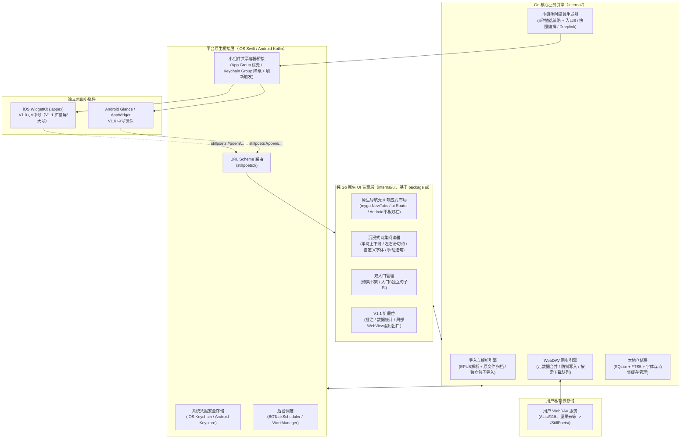
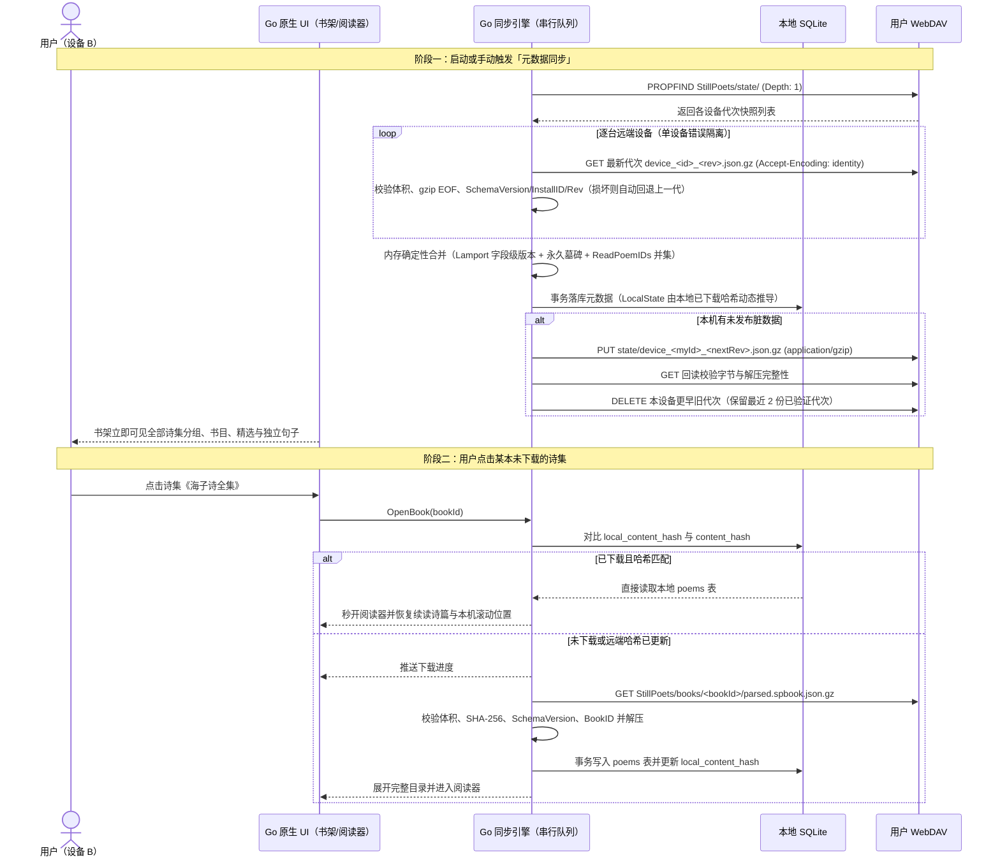
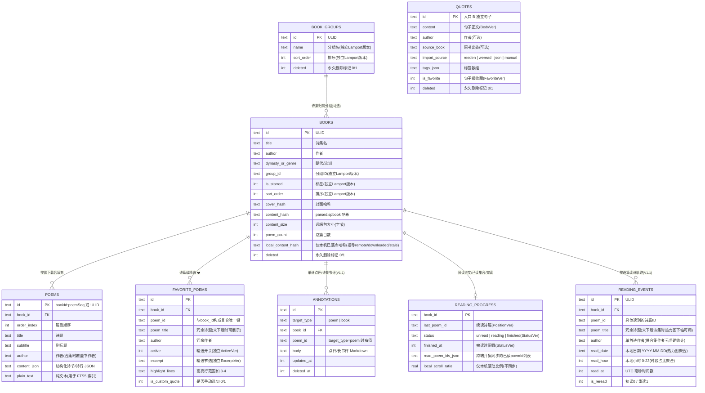

# StillPoets 系统架构设计文档

> **文档状态**：v0.3（V1.0 架构与 Per-Device 代次快照同步协议已定稿，基于 [prd.md](./prd.md)）
> **目标平台**：第一期仅支持 **iOS（iPhone）与 Android（优先适配平板大屏）**；后续可考虑扩展 **Web / PWA**；**明确不做 Windows / macOS 桌面端**
> **核心技术栈**：**MyGo 纯 Go 原生 UI（`package ui`，Metal / OpenGL ES 渲染，V1.1 复杂页面按需局部混用 WebView）** + SQLite (FTS5) + WebDAV（元数据同步 + 诗集原文件与解析包按需下载）+ 原生双端桌面小组件（WidgetKit / Glance）

---

## 1. 架构设计原则与核心选型

### 1.1 设计原则
1. **BYOD 数据私有与零版权风险**：无中心化内容服务器；所有诗集与用户创作数据均保存在用户自己的 WebDAV 目录中，应用仅作为渲染、管理与同步端。
2. **元数据与内容实体分离（类 Reeden 模式）**：
   - V1.0 多端仅自动同步收敛后的轻量**元数据层**（诗集分组 `groups`、书架索引 `books`、诗篇小红心 ❤️ `favorites`、入口 B 独立句子库 `quotes`、阅读进度与已读诗篇集合 `progress`）；外观主题/字号/小组件规则与自定义字体留在**本机**，V1.1 再扩展批注与统计事件。
   - **诗集正文文件不自动全量拉取**；仅当用户主动点击某本诗集（或主动缓存 / 设为离线阅读）时，才按需从 WebDAV 下载到本地。
3. **单一逻辑内核（Single Core）**：WebDAV 同步、文件解析、冲突合并、全文检索、小组件快照生成全部下沉到 Go 核心层，UI 层只负责状态消费与排版渲染。
4. **内外联动一致**：桌面小组件与 App 主界面共享同一套主题 Token 与 Deeplink 协议，确保“外看诗选，内阅全诗”无缝衔接。

### 1.2 为什么选择 MyGo 纯 Go 原生 UI（局部按需混用 WebView）
- **单语言纯 Go，零前端工程负担**：一期使用 `mygo.json` + Go `package ui`，无需 Node.js / npm / Vite / IPC 序列化层，业务状态与 UI 直接在内存里响应式联动，开发链路极致精简。
- **极致性能与原生移动端手感**：不启动 WebView，直接经 Metal（iOS）与 OpenGL ES（Android）绘制；原生集成 `mygo.NewTabs`（iOS 原生 TabBar / Android Material 底部导航）、`ui.Router` 的 `SystemStack`（iOS 边缘右滑返回）以及 `ui.RegisterFont` 动态加载用户自定义字体（TTF/OTF）。
- **优雅的渐进混合架构**：MyGo 天然支持同一应用内混用原生 UI 窗口与 WebView 窗口——V1.0 全部采用纯 Go 原生 UI 保证轻快；到了 V1.1 如果古诗词竖排排版或复杂报刊/宣纸长图导出用 CSS/Canvas 更高效，可仅对单个子页面按需挂载局部 WebView，互不牵制。
- **天然预留 Web 端可能**：MyGo 原生 UI 支持 `mygo build -platform web`（WebAssembly + WebGL 2），后续按需扩展轻量 Web 访问端无需重写整套页面。
- **移动端原生插件与小组件通路完备**：
  - 官方插件覆盖 `sqlite`（含 FTS5）、`background`（`BGTaskScheduler` / `WorkManager`）、`preferences`、`share`、`haptics`、`glass`。
  - 原生模块（`mygo native`）可直接用 Swift / Kotlin 桥接系统能力。
  - **iOS 小组件打包通路**：MyGo `main` 分支已通过 `ios.extensions` 支持将预编译的 `.appex` 嵌入主包 `PlugIns/` 并使用独立或通配符 Provisioning Profile（支持 `app-store` / `ad-hoc` / `enterprise`）分级签名；Android 侧可通过 `mygo-plugin.json` 直接向 Gradle 宿主注入 Kotlin Widget 与 Manifest 声明。

> **版本约束说明**：`ios.extensions` 能力位于 MyGo `main` 分支（`v0.10.0` 之后新增），项目初期构建 iOS 需基于 MyGo `main` 或待下一正式小版本发布后锁定版本。

---

## 2. 总体系统架构



---

## 3. 推荐仓库目录结构

```text
StillPoets/
├── mygo.json                      # MyGo 纯 Go 应用配置（零 JS 依赖，含 ios.extensions / android 配置）
├── go.mod / go.sum
├── main.go                        # 应用入口：初始化原生 Tab、路由、主题/字体加载、注册 Deeplink
├── docs/
│   ├── prd.md                     # 产品需求文档
│   └── architecture.md            # 本架构设计文档
├── internal/
│   ├── app/                       # 应用状态容器与用例编排（协调 Core 与 UI 刷新）
│   ├── domain/                    # 核心领域模型（Book / Poem / Stanza / Quote / Annotation / Favorite）
│   ├── parser/                    # 导入解析器（V1.0 主力 EPUB + 独立句子；后续扩展 MD/JSON）
│   ├── storage/                   # SQLite Schema、迁移脚本、FTS5 检索、诗集与自定义字体本地缓存管理
│   ├── sync/
│   │   ├── webdav/                # WebDAV 客户端（PROPFIND/MKCOL/GET/PUT/防重定向降级/Retry-After/限流）
│   │   ├── protocol.go            # Per-Device 代次快照与 .spbook 编解码、工作区初始化
│   │   ├── merger.go              # 基于 Lamport 逻辑时钟的字段级确定性合并引擎
│   │   ├── engine.go              # 串行同步调度、代次发布与回读校验、安全导书上传、旧设备退役
│   │   └── downloader.go          # 诗集按需下载调度器（带进度、SHA-256 校验与取消）
│   ├── widget/                    # 小组件候选池筛选、Timeline 快照生成、Deeplink 解析
│   └── ui/                        # 纯 Go 原生 UI 层（package ui）
│       ├── theme/                 # 宣纸 / 暗黑 / 磨砂等主题 Token + ui.RegisterFont 字体管理
│       ├── layout/                # 响应式布局框架（手机单栏 + Android 平板双栏/黄金阅读列宽）
│       ├── components/            # 通用诗意组件（书封卡片、诗行选择器、下载进度遮罩、空态）
│       └── pages/
│           ├── shelf/             # 入口 A：诗集书架（云端/下载中/已下载状态）
│           ├── reader/            # 沉浸阅读器（单诗上下滑、左右滑切诗、小红心、手动选金句）
│           ├── quotes/            # 入口 B：独立句子库与出处聚合筛选
│           └── settings/          # WebDAV 配置、同步策略、自定义字体、小组件外观设置
├── native/
│   ├── modules/
│   │   ├── keyring/               # mygo native 模块：移动端安全凭据存储（iOS Swift / Android Kotlin）
│   │   └── widgetbridge/          # mygo native 模块：写 App Group / Keychain 降级通道 + 刷新小组件
│   ├── ios/
│   │   └── StillPoetsWidget/      # 独立 Xcode WidgetKit Extension 工程 -> 产出 build/StillPoetsWidget.appex
│   └── android/
│       └── widget-plugin/         # mygo-plugin.json + Jetpack Glance Widget Kotlin 实现
└── scripts/
    └── build-ios-widget.sh        # 自动化编译 StillPoetsWidget.appex 并同步版本号的构建脚本
```

---

## 4. WebDAV 存储规范与多端同步设计（Per-Device 代次快照 + 按需下载）

> **设计背景**：WebDAV 本质是无事务、无可靠锁、各家后端行为差异极大的远程文件协议（坚果云严格限流 429，AList/OpenList + 115 挂载点对覆盖式 `MOVE`、`If-Match` 乐观锁与 `ETag` 支持不稳定）。StillPoets 面向单人 2~3 台设备（iPhone + Android 平板）低频读写场景，采用 **「Per-Device 单写者代次快照 + 不可变内容包按需下载」** 架构，彻底消除跨设备并发写冲突与共享清单半同步损坏。

### 4.1 V1.0 同步范围红线

| 数据项 | V1.0 是否跨端同步 | 原因与约束 |
| --- | --- | --- |
| **诗集内容包**（`parsed.spbook.json.gz` + `cover.webp` + 原始 `.epub`） | ✅ **同步（一次写入，按需下载）** | 不可变对象，天然零冲突；删书仅软删元数据，不自动删远端实体文件（设置页提供手动清理孤儿文件入口，并提示会移除原 EPUB 恢复源）。 |
| **诗集自定义分组**（`groups`） | ✅ **同步** | 轻量集合，完整支持新建空组、重命名、排序与解散；组解散后引用该组的书自动归入默认「全部诗集」。 |
| **书架元数据**（`books`） | ✅ **同步** | 字段级版本控制（分组、标星、排序互不覆盖）；`LocalState` 严格不入快照，由本机已下载哈希推导。 |
| **诗篇精选池 ❤️**（`favorites`） | ✅ **同步** | 按 `(bookId, poemId)` 合并与落库 upsert；收藏开关与金句节选独立版本化。 |
| **入口 B：独立句子库**（`quotes`） | ✅ **同步** | 纯文本体积小，按 `quoteId` 合并，永久墓碑防复活。 |
| **阅读进度**（`progress`） | ✅ **同步（续读诗篇 + 完读状态 + 已读 `poemId` 集合）** | 砍掉 `scrollRatio`（受屏幕/字号影响，留在本机）；同步 `readPoemIds` 并集去重，保证双端完读进度一致。 |
| **主题 / 字号 / 行高 / 小组件配置** | ❌ **仅本机** | 手机与平板的排版和小组件展示诉求天然不同；本地小组件若引用到已删诗集自动回退可用来源。 |
| **自定义字体文件** | ❌ **V1.0 仅本机导入** | 避免大体积二进制耦合进核心同步状态机；缺失时优雅回退内置字体。 |
| **批注 / 长书评 / 读诗统计热力图** | ❌ **留到 V1.1** | V1.0 聚焦核心阅读与收藏闭环，收敛复杂度。 |

### 4.2 远端目录初始化与结构规范
用户在设置页输入 WebDAV 地址、用户名、应用密码后，默认在输入地址下创建隔离目录 **`StillPoets/`**（可自定义）：
1. 连接验证先执行 `PROPFIND (Depth: 0)` 检测连通性与鉴权，再按层 `MKCOL` 创建 `state/` 与 `books/`（遇 `405`/`301` 须以 `Depth: 0 PROPFIND` 二次确认目标确为集合目录）。
2. 初始化同时检测 `state/` 是否已有设备快照（提示首次拉取合并）以及根目录是否存在旧版 `manifest.json`（提醒迁移或切换目录，绝不静默覆盖）。

```text
<user_webdav_url>/StillPoets/
├── state/                            # 【元数据层：每设备单写者，按代次发布】
│   ├── device_<installA>_12.json.gz  # 设备 A 上一份已验证快照（保底回退）
│   ├── device_<installA>_13.json.gz  # 设备 A 最新已验证快照
│   ├── device_<installB>_5.json.gz   # 设备 B 上一份已验证快照
│   └── device_<installB>_6.json.gz   # 设备 B 最新已验证快照
└── books/                            # 【内容实体层：不可变，严格按需下载】
    └── <book_id>/
        ├── parsed.spbook.json.gz     # 标准化解析后的结构化诗集包（书->篇->节->行，gzip 压缩）
        ├── cover.webp                # 缩略封面（懒加载，失败降级占位图）
        └── <原文件名>_<随机短ID>.epub  # 默认同步备份原始导入文件（保留原名可读性 + 6位随机ID防重名）
```

> **核心设计亮点**：
> 1. **零并发写冲突 + 断电自愈**：每台设备拥有不随系统备份克隆的随机 `installId`，**只写 `state/device_<installId>_<rev>.json.gz`**，绝不触碰其他设备文件；每次提交写新代次 `rev`，**回读校验通过后再清理本设备更早代次，始终保留最近 2 份已验证快照**。即便在关闭原子 `MOVE` 的 AList/115 上中途断网写残最新文件，其他设备也能自动回退读取上一代有效快照。
> 2. **跨端 ID 强一致的 `.spbook.json.gz`**：A 设备导入 EPUB 本地解析生成稳定 `bookId / poemId / stanzaIndex / lineIndex`；B 设备按需下载后无需重复启发式拆诗，确保 ❤️ 精选、已读集合、小组件高亮行号 100% 精准对应。

### 4.3 同步触发时机与按需下载完整流程

- **触发策略**：前台启动静默拉取 + 关键写操作（导书、分组、句子、点 ❤️、退出阅读页）防抖 **5~10 秒**推送 + 书架/设置页手动同步按钮；同一工作区共用**串行同步锁**（绝不并发发旧请求覆盖新请求）；不做后台保活轮询和翻页实时同步。
- **安全导书顺序**：本地先持久化待传任务（`pending_uploads` 表），**先上传并回读校验 `parsed.spbook.json.gz` 与原始 `.epub` 可读，再发布包含该书的 `state/` 快照**；另一端如遇网盘写后读延迟导致短暂 404，保留书目并退避重试。



### 4.4 确定性冲突合并规则（Lamport 逻辑时钟）
彻底放弃依赖设备系统墙钟的时间戳裁决（避免单台设备时钟快偏污染全库），所有可同步变更均使用持久化 **Lamport 逻辑版本 `Version{Counter, InstallID}`**：
- 本地产生写操作时：`counter = max(localCounter, maxVerifiedRemoteCounter) + 1`；全序比较先比 `Counter`，再按 `InstallID` 字典序决胜，转发他端记录时原样保留原版本。
- 数学保证：所有集合与字段合并均严格满足**交换律、结合律、幂等性**，与三台以上设备的拉取顺序完全无关。

| 数据集合 | 合并主键 | 字段级 / 集合级合并策略 | 删除语义 |
| --- | --- | --- | --- |
| **诗集分组**（`groups`） | `groupId` | `Name`（`NameVer`）、`SortOrder`（`SortVer`）独立合并 | **永久删除（吸收状态）**；解散后原引用书目归入默认组 |
| **诗集元数据**（`books`） | `bookId` | 导入内容组（`ContentVer`）与 `GroupID`、`IsStarred`、`SortOrder` 各自独立版本合并；不含 `LocalState` | **永久删除（吸收状态）**，重导使用新 ID；删书后界面一并隐藏其精选/进度 |
| **诗篇精选池 ❤️**（`favorites`） | `(bookId, poemId)` | `Active`（`ActiveVer`）与节选组 `Excerpt/HighlightLines/IsCustomQuote`（`ExcerptVer`）独立合并；落库按复合键 upsert | 取消保留墓碑，**仅显式重新点亮可恢复**，编辑节选绝不复活收藏 |
| **独立句子**（`quotes`） | `quoteId` | 正文/出处/标签组（`BodyVer`）与收藏标记（`FavoriteVer`）独立合并 | **永久删除（吸收状态）**，普通编辑绝不复活已删句子 |
| **阅读进度**（`progress`） | `bookId` | 续读位置 `LastPoemID`（`PositionVer`）与完读状态 `Status/FinishedAt`（`StatusVer`）独立合并，日常翻诗不倒退完读；**`ReadPoemIDs` 按并集去重合并** | 随书目生命周期隐藏；`LocalScrollRatio` 仅留本机 |

### 4.5 WebDAV 工程兼容性加固（AList/OpenList + 115 & 坚果云实操防护）
1. **默认直接 `PUT` + 代次快照**：不依赖易故障的覆盖式 `MOVE`、`If-Match` 或 `ETag`（仍保留可选 `AtomicUpload` 开关供标准 NAS 使用）。
2. **安全重定向策略**：严格限制同源且保留 HTTP 方法的重定向，拒绝反代把 `PUT`/`PROPFIND`/`MKCOL` 经 `301`/`302` 降级为 `GET` 造成误报成功，绝不跨域泄露 Basic Auth。
3. **防止代理透明解压破坏哈希**：所有 `.gz` 上传声明 `Content-Type: application/gzip`，下载强制 `Accept-Encoding: identity` 并禁用 HTTP 客户端自动解压，按原始字节校验 SHA-256 与体积上限。
4. **低并发与 `Retry-After` 限流退避**：并发信号量（默认 2）覆盖**完整响应体读取生命周期**；遇到 `429 / 502 / 503 / 504` 优先遵守 `Retry-After` 头，辅以有上限指数退避与随机抖动。
5. **健壮的 `PROPFIND` 解析与 URL 转义**：支持多 `<propstat>` 逐状态过滤（仅采纳 2xx），按 `href` 精确解析直接子项并排除目录自身；`resolveURL` 保留基址原有转义段（如 `%2F`）。
6. **旧设备安全退役**：V1.0 不按文件年龄自动清理其他设备快照；重装/换机后通过手动「退役旧设备」流程，**先验证现役设备合并后的远端快照可读有效**，再清理旧 `installId` 的快照文件。

### 4.6 诗集解析包（`SPBook`）非诗元素与附属结构规范
真实诗集 EPUB 除正式诗篇外，常包含译序/导读/后记、跨章脚注/尾注、插图及分辑/题记/落款。为保证小组件抽选纯净、完读统计准确且 `parsed.spbook.json.gz` 保持轻量化，解析器统一遵循以下契约（对应 `internal/domain/models.go`）：

1. **条目类型区分（`Poem.Kind`: `poem` | `prose`）**：
   - `poem`：正式诗篇，计入 `Book.PoemCount`、完读进度、❤️ 精选与桌面小组件候选池。
   - `prose`：译序、序言、导读、后记、年表等非诗附文，保留在目录中并以散文段落排版供阅读，**默认不计入完读篇数与小组件候选池**。
   - 版权页（ISBN/CIP）、HTML 目录页、封面页 HTML 与空白页在解析阶段自动过滤（不入正文主目录）。
   - 解析器基于标题关键词与文本结构特征给出自动分类，导入预览页允许用户一键微调（例如将散文诗改标为 `poem` 或剔除无用附文）。
2. **注释抽取与内联（`Poem.Notes []Note`）**：
   - 自动解析 EPUB `noteref` / `footnote` 锚点（含跨文件尾注章）及诗末附注，将注释文本内联归属到对应诗篇/附文的 `Notes` 数组，并将纯尾注章从主目录剥离。
   - 阅读器点击行内上标即弹出轻卡片展示（不跳离当前诗），诗末柔和附注；小组件与默认节选自动剥离行内注释标号（如 `[1]` / `①`）。
3. **图像策略（V1.0 暂不渲染正文插图，预留结构）**：
   - 书籍封面提取为独立 `cover.webp`；装饰线与出版社 Logo 过滤；带 `alt` 的生僻字小图直接回填文字。
   - 正文插图**严禁 Base64 写入 `.spbook.json.gz`**；V1.0 仅在 `Poem.Images []ImageRef` 预留路径/图注元数据，暂不打包上传 `media.zip` 或渲染正文插图（留到 V1.1 扩展）。
4. **诗歌高频附属结构**：
   - `Section`（分辑/卷名，供目录分组）、`Epigraph`（诗前题记，独立排版不混入首节）、`Colophon`（诗末日期/地点落款，浅灰右对齐且**排除出小组件抽选**）、`SPBook.Translator`（译者）。

---

## 5. 本地数据模型设计（SQLite + FTS5）

本地 SQLite 严格区分**常驻元数据表**与**按需落库正文表**，并在用户清理缓存时仅清空对应 `book_id` 的正文表数据，不影响收藏、精选、点评与书架元数据。



- **全文检索（FTS5）**：
  - 建立 `quotes_fts`（始终索引全部独立句子、作者、原书出处）与 `poems_fts`（对已下载的诗集正文建索引，清理某诗集缓存时同步移除其 FTS 条目）。
- **缓存空间治理**：
  - 提供「本地存储管理」页面：按诗集展示已占用空间，支持单本「仅移除本地下载（保留云端与精选/点评）」或一键释放非近期阅读缓存。

---

## 6. 桌面小组件与内外联动架构

### 6.1 统一小组件快照协议（Widget Snapshot）
原生小组件运行在受限扩展进程中（iOS WidgetKit 内存上限约 30MB），**绝不能在 Widget 进程里加载 Go 运行时或访问 WebDAV**。

采用**“主 App 预编译时间线快照 + 原生轻量渲染”**架构：
1. 每当用户修改收藏/精选池、切换小组件配置、或后台任务唤醒时，Go 引擎生成一份轻量的 `widget_timeline.json`（通常 < 50KB），包含未来 24 小时按策略抽选好的多条条目：
   ```json
   {
     "generatedAt": 1763654400,
     "theme": {
       "preset": "xuan_paper",
       "fontFamily": "Songti",
       "bgColor": "#F7F3E9",
       "textColor": "#2C2824",
       "accentColor": "#8C3B2B"
     },
     "entries": [
       {
         "entryType": "poem",
         "displayText": "我有一所房子，面朝大海，春暖花开",
         "poemTitle": "面朝大海，春暖花开",
         "author": "海子",
         "bookTitle": "海子诗选",
         "deeplink": "stillpoets://poem/01JXYZ.../p_042?lines=4-4&highlight=1"
       },
       {
         "entryType": "quote",
         "displayText": "黑夜给了我黑色的眼睛，我却用它寻找光明。",
         "author": "顾城",
         "sourceBook": "一代人",
         "deeplink": "stillpoets://quote/01JABC..."
       }
     ]
   }
   ```
2. **与「按需下载」的无缝协同**：
   - 即使某本诗集在当前设备尚未下载正文，只要它的精选诗篇已通过设备快照同步到本地 `favorite_poems` 表（自带轻量 `excerpt`），小组件依然可以正常展示该诗句。
   - 用户点击小组件触发 `stillpoets://poem/<bookId>/<poemId>?lines=4-4` 后：
     - 主 App 通过 `mygo.App.OnOpenURL` 收到路由并驱动 `ui.Router` 跳转。
     - 若该诗集已下载：直接进入整诗页面并短暂高亮第 4 行。
     - 若该诗集为 `remote` 状态：自动进入阅读页过渡态，立即按需拉取 `parsed.spbook.json.gz`，完成后无缝展开整首诗并高亮第 4 行。

### 6.2 双端原生小组件集成方案（基于 MyGo）

| 维度 | iOS / iPadOS（WidgetKit） | Android（Jetpack Glance / AppWidget） |
| --- | --- | --- |
| **工程形态** | `native/ios/StillPoetsWidget/` 独立 Xcode Extension 工程，编译产物为 `.appex` | `native/android/widget-plugin/` 作为 MyGo Android 插件注入 `.mygo/android` Gradle 工程 |
| **打包集成** | `mygo.json` 配置 `ios.extensions` 指向 `build/StillPoetsWidget.appex`，支持 `app-store` / `ad-hoc` / `enterprise` 通配符 Profile 分级签名 | `mygo-plugin.json` 声明 `sources`、`dependencies`（`androidx.glance:glance-appwidget`）及 `application`（`<receiver>`） |
| **数据共享通道** | **双通道自适应**：优先走可配置的 **App Group**（`widget_timeline.json` + 自定义字体）；若当前企业/个人通配符 Profile 未开通 App Groups，则自动降级走同 Team 共享的 **Keychain Access Group** 传递 `widget_timeline.json` | 应用私有目录 / `SharedPreferences` 写入 `widget_timeline.json` 与字体路径（同进程/同 UID 直接可读） |
| **刷新触发** | `widgetbridge` Swift 原生模块调用 `WidgetCenter.shared.reloadAllTimelines()` | `widgetbridge` Kotlin 原生模块触发 `GlanceAppWidgetManager.updateAll()` / `APPWIDGET_UPDATE` 广播 |
| **后台轮换** | WidgetKit 原生 `TimelineProvider` 按小时消费快照 + MyGo `plugins/background`（`BGAppRefreshTask`）定期补货 | `WorkManager`（MyGo `plugins/background`）定时刷新快照并通知微件重绘 |
| **Deeplink 唤起** | `widgetURL(URL(string: entry.deeplink))` -> `mygo.App.OnOpenURL` | `PendingIntent` 携带 `stillpoets://` Intent -> `mygo.App.OnOpenURL` |

---

## 7. 安全与隐私架构

1. **凭据与数据分离**：WebDAV 账号密码/应用密码仅存放在设备系统级安全存储（iOS Keychain、Android Keystore），通过 `native/modules/keyring` 读取；绝不落盘到 `settings.json`、SQLite 或日志中。
2. **传输安全**：默认强制校验 TLS 证书（HTTPS），仅当用户显式勾选「允许局域网 HTTP / 自签名 NAS」时才放行内网明文或自签名证书连接，并在 UI 明确提示风险。
3. **数据损坏防护**：
   - 下载诗集包校验体积、SHA-256、SchemaVersion 与 BookID，校验失败不覆盖本地有效数据。
   - 元数据写入先走本地 SQLite 事务，再按新代次上传到 `state/device_<installId>_<rev>.json.gz` 并回读校验，始终保留最近 2 份已验证代次，损坏自动回退上一代。

---

## 8. 工程落地与演进路线

| 阶段 | 核心交付物 | 关键验证点 |
| --- | --- | --- |
| **Phase 0：骨架与协议固化** | 初始化 MyGo 项目骨架、定义 `.spbook` 与 Per-Device 代次快照 Schema、实现 `internal/sync`（Lamport 合并引擎 + 安全 WebDAV 客户端） | 连接 AList(115) / 坚果云自动建 `StillPoets/state/` 与 `books/` 目录、完成双端代次快照合并与坏文件回退、原文件 `<原名>_<随机ID>.epub` 上传校验与 `Retry-After` 限流重试验证 |
| **Phase 1：V1.0 核心阅读与双入口 MVP** | EPUB 解析器 + 入口 B 独立句子库、SQLite + FTS5、书架按需下载状态机、横排沉浸阅读器（上下滑读长诗 + 左右滑切诗 + **自定义字体**）、诗集/诗篇 ❤️ 收藏、**Android 平板大屏双栏适配** | 在 Android 平板真机 + iOS 跑通“导入 EPUB 上传原文件与解析包 -> 另一端仅同步元数据 -> 点击诗集按需下载 -> 左右滑切诗 & 换自定义字体”闭环 |
| **Phase 2：V1.0 双端基础小组件联动** | `widgetbridge` 原生模块、iOS WidgetKit（小/中号，3 套预设主题 + 自定义字体）、Android Glance 微件（中号）、阅读器手动选句设为本诗金句、`stillpoets://` Deeplink 高亮跳转 | 小组件支持 4 种抽选模式 + 入口 B 数据源 -> 点击唤起 App -> 未下载诗集自动拉取并高亮定位到指定诗行 |
| **Phase 3：V1.1 批注、统计、卡片与竖排** | 单诗微批注与长书评、数据统计（完读墙/按篇热力图/时段占比/作者云）、高清卡片导出引擎、古诗词竖排阅读（复杂排版页按需局部混用 WebView）、iOS 锁屏/大号小组件；后续按需评估 `mygo build -platform web` | 多端离线编辑书评冲突合并无丢数据；热力图在未下载诗集端可正常下钻展示；小组件与导出卡片主题视觉一致 |
